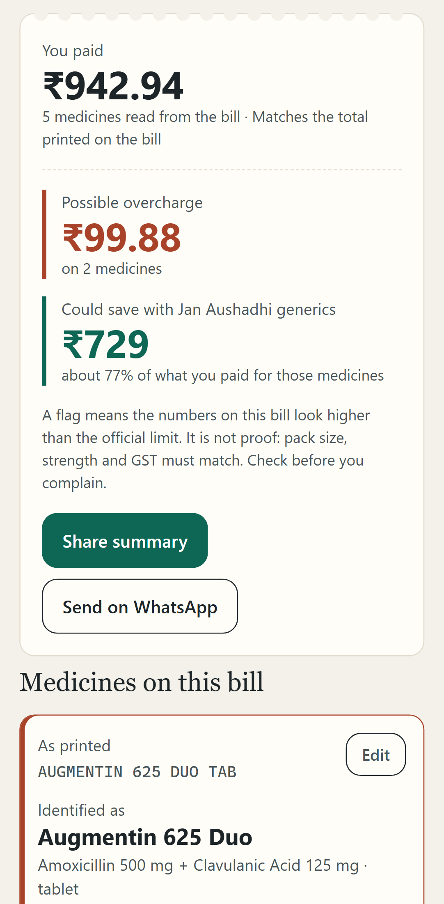

# Bill Lens

Photograph an Indian pharmacy bill. Bill Lens reads it on your phone, works out the salt and strength of each medicine, checks the price you paid against the government's NPPA ceiling price and the MRP printed on the bill, and shows what the same medicine costs at a Jan Aushadhi Kendra.

The bill never leaves the device. There is no server, no account and no API key: OCR, matching and the price checks all run in the browser, and the app works offline once it has loaded.

Live: https://satanrayshe.github.io/bill-lens/



## What it does

1. **Reads the bill.** Take a photo or upload one. The image is straightened, flattened against uneven light and cleared of table rules, then read with Tesseract.js. Line items (name, pack, quantity, MRP, rate, GST %, amount) are pulled out of the text. Every field can be corrected, and medicines can be typed in by hand.
2. **Identifies each medicine.** The printed name ("AUGMENTIN 625 DUO TAB", "STAMLO S TAB" with an OCR'd 5) is matched against about 244,000 Indian brand entries to get its salts, strengths and dosage form. Lines that print the generic name ("PARACETAMOL 500MG TAB") are handled too.
3. **Checks the price.**
   - **NPPA ceiling price** for scheduled formulations under DPCO 2013. Ceiling prices are per unit (one tablet, one capsule, one ml) and exclude GST. Note (d) of NPPA order S.O. 1575(E) says no one may sell above "the ceiling price (plus Goods and Services Taxes as applicable)". Bill Lens therefore compares the price paid per unit with `ceiling × (1 + GST)`, using the GST % printed on the line or, if none is printed, 5% (the rate for most medicines since 22 September 2025, per PIB). The full calculation is one tap away on every line, with the S.O. number and serial number of the notification row.
   - **Charged above the printed MRP**, when the bill shows the MRP.
   - **Jan Aushadhi (PMBJP) generic** with the same salt, strength and dosage form, from the official product list, with its MRP and the saving on that line.
4. **Summarises** the total paid, possible overcharges and possible savings in large numbers, with a confidence label on every line and a reminder that strength, pack size and form must match and that a doctor or pharmacist should confirm any switch.
5. **Says what to do next**: keep the bill, ask the pharmacist to recheck, complain through NPPA's Pharma Sahi Daam app or portal, call the NPPA helpline (1800 111 255, working days 10 am to 6 pm), or find a Jan Aushadhi Kendra (PMBI toll-free 1800 180 8080). These were checked on nppa.gov.in and janaushadhi.gov.in on 16 Nov 2026.
6. **Shares** a summary card (PNG) or a WhatsApp message for family.

The interface is available in English and Hindi, and is an installable, offline-capable PWA.

A flag is a prompt to check, not a finding. The app says so on screen.

## How it works

```
photo ─▶ preprocess (JS) ─▶ Tesseract.js LSTM ─▶ line parser ─▶ matcher ─▶ price checks ─▶ summary
          deskew, flat-field,     self-hosted,      header +        trigram       NPPA ceiling
          rule removal            cached offline    token shapes +  retrieval +   MRP, PMBJP
                                                    arithmetic      learned scorer
```

- `app/src/core/preprocess.js`: greyscale, flat-field correction (divide by a blurred max-filtered background), percentile contrast stretch, skew estimate from projection profiles, removal of long horizontal and vertical rules. Pure JS on RGBA buffers, so the same code runs in the browser and in the Node evaluation.
- `app/src/core/parse.js`: finds the column header (Qty / MRP / Rate / Amount / Pack / GST / Disc), classifies tokens (batch numbers, expiry dates, pack sizes like `1x15` and `15'S`), merges two-line thermal-receipt items, and picks quantity, rate and amount by **arithmetic consistency**: `qty × rate × (1 − discount) = amount`. The same search repairs the most common OCR error on bills, a dropped decimal point (`21254` read for `212.54`).
- `app/src/core/matcher.js`: character-trigram retrieval over about 117,000 brand "family" words, then every brand variant in the retrieved families is scored by a linear model over 13 features (edit distance with OCR-confusion-aware costs, word overlap, whether the strength numbers on the bill are explained by the candidate, unexplained extra words such as `CV` or `LS`, dosage form and pack agreement). The weights (`app/public/models/matcher.json`) are learned with a listwise softmax loss on OCR output from the training bills plus simulated OCR noise (`scripts/train_matcher.py`). When several strengths of one brand fit the printed text equally well, the line is marked ambiguous and a price flag is only kept if it holds for every reading.
- `app/src/core/check.js`: decides whether quantity and rate are per strip or per tablet (from the printed MRP, the column header, the ceiling price or the quantity), then applies the rules above.
- `app/src/engine.worker.js`: loads the data and builds the index in a Web Worker so the page stays responsive on slower phones.

### Why not an embedding model?

I tried to keep the matching step small enough for a mid-range Android phone. A sentence-embedding model through transformers.js would add a download of tens of megabytes and still be poor at the thing that matters here, which is telling `Telma 40` from `Telma 80` when OCR has blurred the digits. The trained matcher is a 13-weight model plus a trigram index built on the device, and on the held-out set it gets the salt, strength and form right for 97.3% of extracted lines, against 78.1% for plain fuzzy matching of the brand word.

### Download size

First visit, compressed: OCR engine ~1.5 MB, English LSTM model 2.95 MB, brand table 2.0 MB, price lists 0.08 MB, app 0.04 MB. Everything is cached (service worker plus Tesseract's IndexedDB cache) and progress is shown while it loads.

## Data sources

| Data | Source | Date | Use |
|---|---|---|---|
| Ceiling prices, 767 scheduled formulations (NLEM 2022) | NPPA order S.O. 1575(E), 25 Mar 2026, [PDF](https://nppa.gov.in/storage/uploads/tender/0fd8be342c35d5a46a13b281cadc5e4f.pdf), listed under Circulars/Orders on nppa.gov.in, 27 Mar 2026 | effective 1 Apr 2026 (WPI revision) | 766 table rows extracted, 722 usable after parsing |
| Ceiling prices, 138 scheduled formulations (NLEM 2015) | NPPA order S.O. 1581(E), [PDF](https://nppa.gov.in/storage/uploads/tender/0d883ca9b600c8a13cec452376176fc4.pdf) | effective 1 Apr 2026 | 138 rows extracted, 118 usable |
| Jan Aushadhi "Product & MRP List" | [janaushadhi.gov.in/product-portfolio/product-mrp-list](https://janaushadhi.gov.in/product-portfolio/product-mrp-list), 2,453 products | fetched 16 Nov 2026 | 1,715 products with an MRP and a parseable salt/strength |
| Brand to composition | [Indian Medicine Dataset](https://github.com/junioralive/Indian-Medicine-Dataset) by JuniorAlive, MIT licence | downloaded 16 Nov 2026 | 243,893 active allopathic entries, names and compositions only; its prices are not used |
| GST on medicines | PIB, GST rate changes effective 22 Sep 2025 (most medicines 5%, some nil) | 2025 | default GST when the bill does not print one |

The NPPA rows that could not be used are mostly vaccines, IV fluids and "as licensed" entries without a per-unit strength (`data/processed/nppa_skipped.json`). The PMBJP entries left out are mostly multivitamins, kits and products listed with a zero MRP (`data/processed/pmbjp_unparsed.txt`).

`app/public/data/meta.json` records the source URLs, S.O. numbers and SHA-256 hashes of the raw files.

## Evaluation

All numbers come from **synthetic** bill photos: bills rendered from HTML templates with real brand names and invented prices, then turned into phone-like photos (perspective, rotation, blur, uneven lighting, shadow band, sensor noise, JPEG). The pharmacies are fictional and no real bill was used. Overcharged lines were injected deliberately (a fictional pharmacy charging above the NPPA limit or above its own printed MRP).

Splits (generated with different random seeds):

- **train**: 60 bills, 346 lines, used to fit the matcher weights
- **dev**: 20 bills, 103 lines, used while developing the parser
- **test (held out)**: 80 bills, 470 lines, 71 overcharged. Includes a fifth bill layout (`dotmatrix`) that was never used during development.

The evaluation runs the same JS modules as the app, with the same Tesseract.js engine and language model, from the photo onwards.

Held-out test set, end to end from the photo:

| Metric | All 80 bills | Unseen layout only (16 bills) |
|---|---|---|
| Line extraction recall (line found with correct quantity and amount) | 93.4% | 97.9% |
| Line extraction precision | 93.2% | 97.9% |
| Medicine match, salt + strength + form correct (of extracted lines) | 97.3% | 96.8% |
| Medicine match, exact brand | 95.9% | 95.7% |
| Overcharge flag precision (line level) | 88.6% (62 of 70 flags) | 100% |
| Overcharge flag recall (line level, missed lines count as misses) | 87.3% (62 of 71) | 94.4% |
| Bill has at least one overcharge: precision / recall | 95.7% / 100% | 100% / 100% |
| Lines with a Jan Aushadhi equivalent found | 87.0% | 90.4% |
| OCR time per bill (Node, desktop CPU) | 1.1 s | 1.0 s |

Matcher ablation on the same held-out set: ranking candidates by fuzzy brand-word similarity alone gives 78.1% salt + strength + form accuracy, against 97.3% for the trained scorer. The three in-app sample bills are read with 100% line extraction and the expected flags (`eval/results/samples.json`).

Per-layout results are in `eval/results/test.json`. The weakest layout is the cash memo (`chemist`) with a discount column: 80% line extraction on the test set.

The test set was scored twice: once, then again after fixing a bug found on the **training** split (an ambiguity check that treated a syrup and a tablet of the same brand as rival readings). The table shows the second run. In the first run overcharge recall was 81.7% and precision 90.6%; the other metrics were the same.

### Known limits

- Printed bills only. Handwritten bills are not supported.
- The test photos are synthetic. Real photos (creased paper, faded thermal print, glare, very low light) will be harder, and the numbers above should be read as an upper bound.
- English OCR only. Bills printed in Hindi or other scripts are not read.
- Only scheduled formulations have an NPPA ceiling price; for other medicines only the printed MRP can be checked.
- Ceiling checks are made for tablets and capsules, and for oral liquids when the bottle size is known. Injections, IV fluids and devices are not checked.
- The brand table is a community dataset and can be out of date; new brands may be missing and some compositions list only the first two ingredients. You can correct any line.
- GST is assumed to be 5% when the bill does not print it. For GST-exempt medicines the real limit is lower, so the app can miss an overcharge but should not raise a false one for that reason.
- This is not medical or legal advice.

## Run it

Requirements: Node 20+ (and Python 3.11+ only to rebuild data or rerun the evaluation).

```bash
npm install
npm run dev          # http://localhost:5173/bill-lens/
npm run build        # production build in dist/
npx vite preview app --port 4173   # serves dist/ at http://localhost:4173/bill-lens/
npm test             # unit tests for the parser and the price rule
node tests/e2e.mjs   # headless Chromium: samples, upload, Hindi, offline reload, mobile
```

`npm run build` copies the OCR engine and language model from `node_modules` into the site, so nothing is loaded from a CDN. Pushing to `main` deploys to GitHub Pages through `.github/workflows/pages.yml` (set Pages to "GitHub Actions" in the repository settings).

## Rebuild the data

```bash
python -m venv .venv && .venv/bin/pip install pdfplumber playwright numpy
.venv/bin/python -m playwright install chromium
.venv/bin/python scripts/fetch_sources.py   # NPPA PDFs + brand table, checks SHA-256
.venv/bin/python scripts/fetch_pmbjp.py     # Jan Aushadhi product list (opens the public page in a headless browser)
.venv/bin/python scripts/build_data.py      # -> app/public/data/*.json
```

## Rerun the evaluation

```bash
pip install opencv-python-headless torch scikit-learn
python eval/gen_bills.py --split test --n 80 --seed 13 --templates thermal,gst,chemist,hospital,dotmatrix
node eval/ocr_node.js eval/bills/test            # caches OCR output
node eval/run_eval.js eval/bills/test --json eval/results/test.json
BL_MATCHER=fuzzy node eval/run_eval.js eval/bills/test   # ablation
# retrain the matcher (train split only)
node eval/ocr_node.js eval/bills/train
node eval/export_match_pairs.js > data/processed/match_pairs.jsonl
python scripts/train_matcher.py
```

The bill photos and ground truth used for the numbers above are committed in `eval/bills/`. Rendering depends on installed fonts, so regenerated photos will differ slightly.

## Repository layout

```
app/                 the web app (Vite, plain JS, no framework)
  src/core/          preprocessing, OCR line grouping, parser, matcher, price checks (shared with eval)
  public/data/       processed NPPA, PMBJP and brand data
  public/models/     matcher weights
  public/samples/    the three synthetic sample bills
scripts/             data fetch/build, matcher training, asset copy
eval/                bill generator, OCR runner, evaluation, results
tests/               unit tests and the headless browser test
data/raw/            source files (NPPA PDFs, PMBJP list); the brand CSV is downloaded by the script
```

## Licence

MIT, see `LICENSE`. The brand composition data is from the Indian Medicine Dataset (MIT licence, copyright 2024 JuniorAlive). NPPA and PMBJP price lists are public government documents. Tesseract.js and its language data are Apache-2.0.
